# PanelDue Firmware – Modern UI

This is a fork of the official [Duet 3D PanelDue Firmware](https://github.com/Duet3D/PanelDueFirmware) with a modernized user interface.

Notice: This interface has been coded by Claude and ChatGPT. I design the interface mockups and layout and then used LLMs for actual coding. So 100% vibe coded.

## Contents

- [About](#about)
- [UI](#ui)
- [Master tabs](#master-tabs)
  - [CONTROL](#control)
    - [TOOLS](#tools)
    - [MOVE](#move)
    - [EXTRUDE](#extrude)
    - [MACROS](#macros)
  - [STATUS](#status)
    - [PRINTING](#printing)
    - [TUNE](#tune)
    - [JOB](#job)
    - [OBJECT](#object)
  - [FILAMENT MANAGEMENT](#filament-management)
    - [Column contents](#column-contents)
    - [Modes](#modes)
    - [Loading and changing filament (MACROS mode)](#loading-and-changing-filament-macros-mode)
    - [What RRF runs, in order](#what-rrf-runs-in-order)
    - [PANEL mode](#panel-mode)
    - [MMU printers](#mmu-printers)
    - [Printer configuration](#printer-configuration)
    - [During a print](#during-a-print)
    - [Endless spool](#endless-spool)
  - [SYSTEM](#system)
    - [CONSOLE](#console)
    - [SETTINGS](#settings)
- [Software Compatibility](#software-compatibility)
- [Compatible Hardware](#compatible-hardware)
- [Firmware Downloads](#firmware-downloads)
- [Repository status](#repository-status)
- [Original project](#original-project)
- [License](#license)

## About

PanelDue Firmware – Modern UI provides new firmware interface for PanelDue controllers used with Duet 3D electronics. This fork focuses on updating the PanelDue user experience while retaining the functionality and compatibility of the original project.

V2 introduced multi color/ material manegment TAB. ALETR button was removed to accommodate multi material/ color TAB

## UI
UI follows modern tab design: on the left side in the top corner we have the emergency STOP button. Underneath are 4 master tabs: CONTROL, STATUS, FILAMENT MANAGEMENT and, at the bottom, SYSTEM. On the top we have a rail with sub tabs that displays the tabs grouped under each master tab. The rest is content area.

## MASTER TABS

UI is divided into 4 master sections (TABS) on the left vertical rail.


## CONTROL

**[Joystick icon]** CONTROL handles mostly things that are usually done when the printer is idle (not printing). Here reside sub tabs TOOLS / MOVE / EXTRUDE / MACROS.

  ### TOOLS
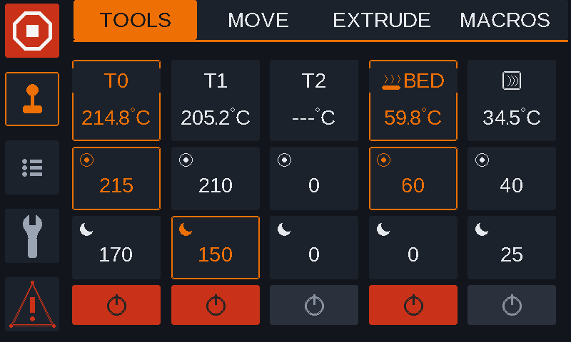

TOOLS lists RRF tools, heating bed, chamber heater and shows current heater temperature plus active/standby targets. Tapping targets edits temperatures, tool headers handle tool selection, and the power tile only turns an active heater off. If there are more than 5 heating elements configured (4 toolheads, bed and chamber heater for example) a second page under tools is created with the buttons to navigate between them shown. First page will in this case hold 4 heater columns and the 2 rightmost columns get pushed to the second page.

  ### MOVE
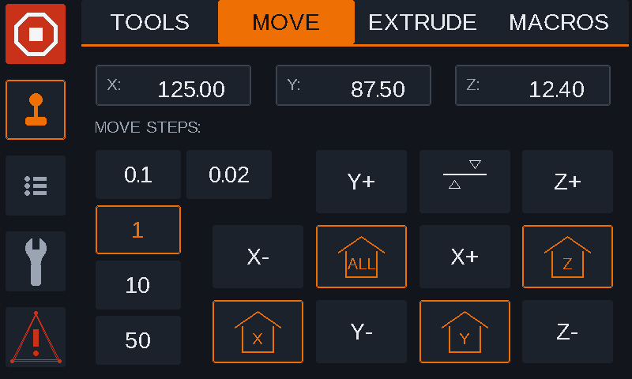

MOVE shows live X/Y/Z positions, selectable jog distance and direct X/Y/Z jog controls. Homing buttons reflect RRF homed state and G32 bed compensation is available from the same page.

  ### EXTRUDE
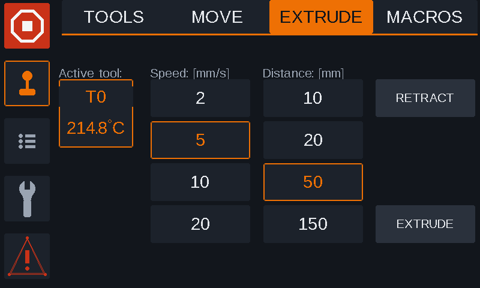

EXTRUDE shows the active tool and nozzle temperature, with preset extrusion speeds of 2/5/10/20 mm/s and distances of 10/20/50/150 mm. Retract/extrude actions are blocked unless an active tool exists and its heater meets RRF's cold-extrusion temperature threshold.

  ### MACROS
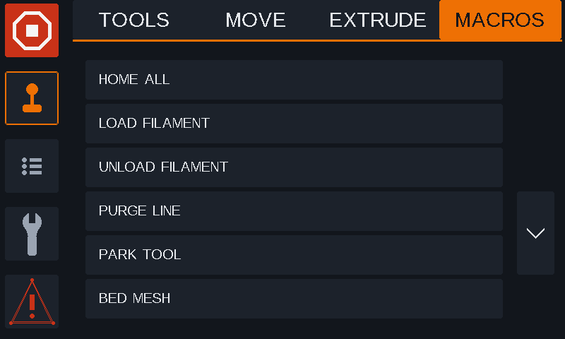

MACROS displays up to six RRF macro entries per page, with folder navigation and paging. Macro files open a confirmation before execution, while folders open directly.


## STATUS

**[List icon]** STATUS handles mostly things that are of interest during printing. Here reside sub tabs PRINTING / TUNE / JOB / OBJECT.

  ### PRINTING
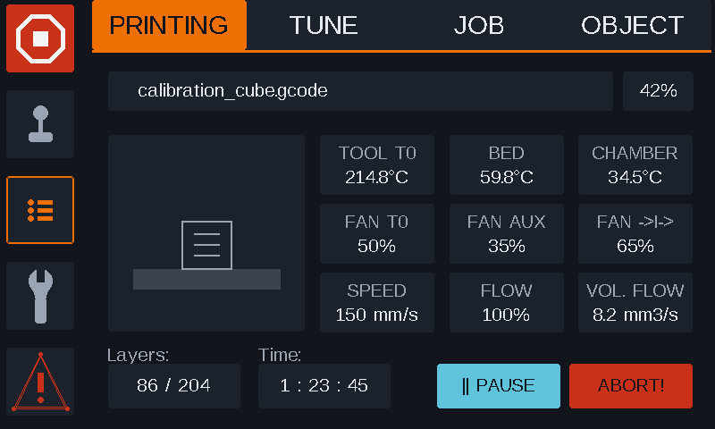

PRINTING shows the active print at a glance with job name, progress, slicer thumbnail and a fixed 3×3 read-only telemetry grid. The page also exposes layer/time summary plus the pause/resume and abort actions when a print is active. Two non-tool fans are identified by their RRF fan names, not by whichever unused fan numbers happen to come first. They need to be named like this so PanelDue assigns the correct tile on the printing screen to them. For the thumbnail to show up you need to add "220x220/QOI" in the slicer.

FAN_AUX → auxiliary fan

FAN_CHA → chamber/filter fan

Example:
```
M950 F2 C"out5"
M106 P2 C"FAN_AUX" H0 L0.8 T35:100
```
For thermostatic fans (configured with `H` and `T`) the tile shows the fan's real speed.

CHAMBER tile:

- **Chamber heater:** if a chamber heater is configured with `M141 P0 H#`, the tile shows
  its temperature (coloured by heater state, like the tool and bed heaters).
- **Sensor only:** without a chamber heater, the tile shows any temperature sensor whose
  name contains "chamber" (`M308 ... A"Chamber"`).
- Otherwise the tile shows `---`.

  ### TUNE
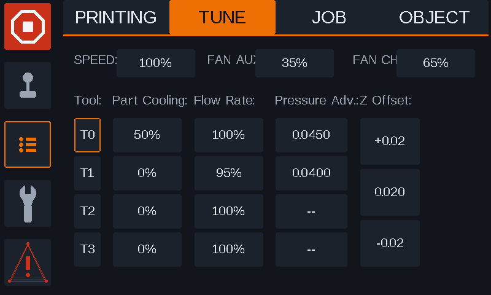

TUNE provides live print adjustments for speed, AUX FAN (FAN_AUX) / CHAMBER FAN (FAN_CHA), per-tool part cooling, flow rate and pressure advance adjustments. Z offset is adjusted directly here using the Z offset step amount selected in SETTINGS.

  ### JOB
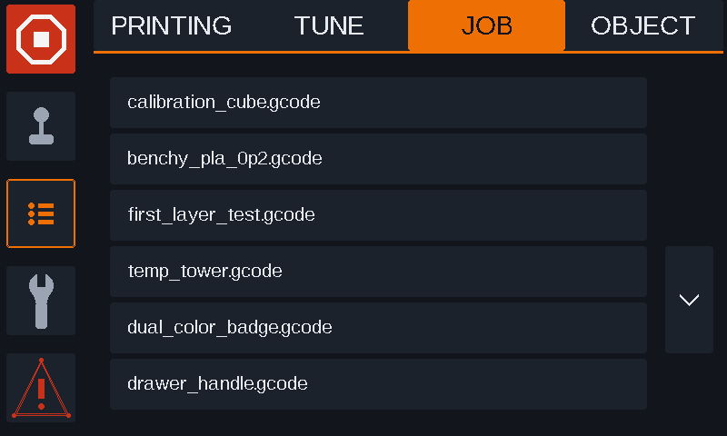

JOB displays the printable file list with six rows per page, optional storage-volume selection and page navigation on the right. Selecting a job opens the print-start pop up window, while directories are navigated through the same list view. It can store up to 72 jobs. 

  ### OBJECT
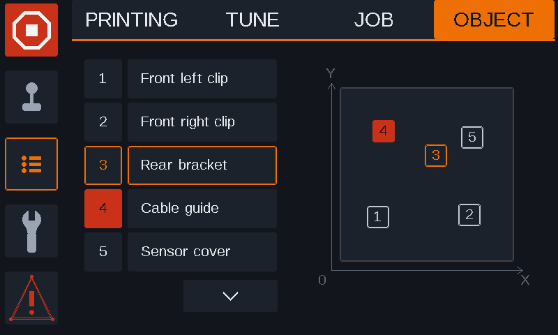

OBJECT lists object-cancellation targets alongside a live top-view placement map with numbered markers. Objects can be selected by row or map marker, and cancelled objects are shown in the dedicated red state.


## FILAMENT MANAGEMENT

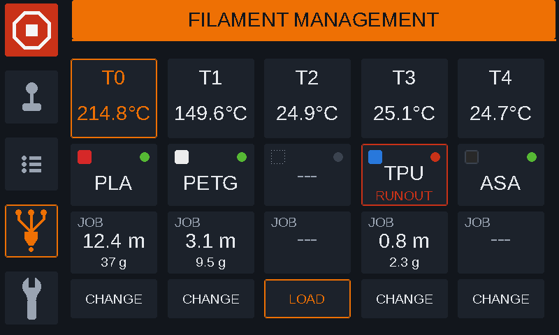
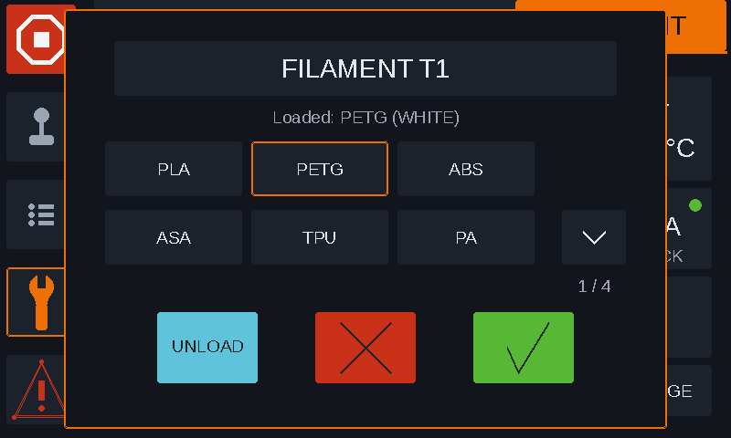
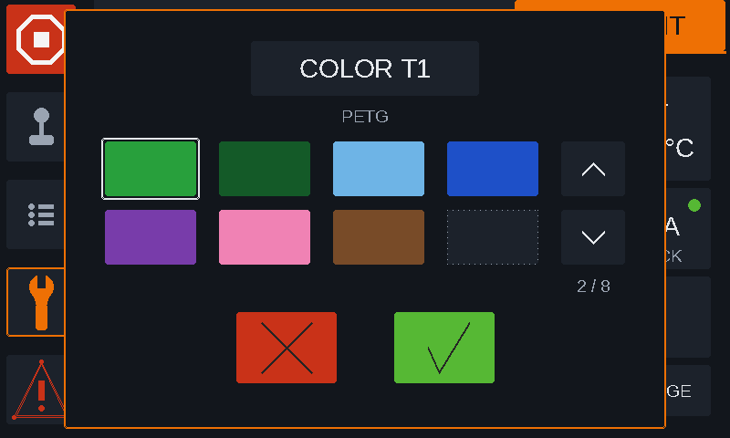
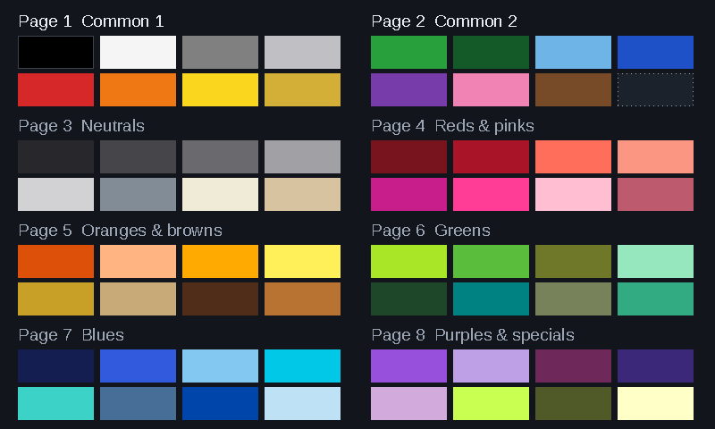

**[Filament icon – three lanes into a nozzle]** FILAMENT MANAGEMENT shows every tool as a column: material, colour, runout state and how much filament the current job needs from it. It works for multi-tool printers and for MMUs.

<!--  -->

Up to **16 tools/lanes** are supported. The columns use the same layout as CONTROL › TOOLS: with more than 5 tools, the page shows 4 per page with up/down arrows.

  ### Column contents
| Tile | Shows | Source |
|---|---|---|
| Header | tool number and nozzle temperature (active tool outlined) | tool heater |
| Material | colour chip, material name, runout dot, RUNOUT warning | `move.extruders[].filament`, `sensors.filamentMonitors[].status` |
| JOB | metres and grams the current job needs from this tool | `job.file.filament[]`; grams = length × filament cross-section × material density |
| Button | CHANGE / LOAD (MACROS mode) or EXTRUDE (PANEL mode) | – |

Runout dot: green = filament OK, red = no filament, grey = other monitor state, dark = no monitor on that extruder.

  ### Modes
Set in SYSTEM › SETTINGS › FILAMENT:

| Mode | Material comes from | Panel sends commands |
|---|---|---|
| **MACROS** | RRF filament system (what `M701` loaded) | yes |
| **PANEL** | chosen on the panel, stored on the panel only | no – information only |
| **AUTO** (default) | MACROS if `0:/filaments` has folders, otherwise PANEL | depends |

AUTO checks the folder list (`M20 S2 P"0:/filaments"`) every time the page opens. Colours (64 to choose from) are always stored on the panel only.

  ### Loading and changing filament (MACROS mode)
1. **Material popup** – lists only materials that have a folder in `0:/filaments`.
2. **Colour popup** – pick a colour (✗ keeps the current colour, the load still happens).
3. The panel sends:
   ```
   T<n>               ; only if this tool is not already selected
   M702               ; only if a filament is loaded – runs that filament's unload.g
   M701 S"<name>"     ; runs /filaments/<name>/load.g, then config.g
   ```
   Choosing the same material again only changes the colour – nothing is sent.

**UNLOAD** in the popup sends `T<n>` (if needed) and `M702`.
Tapping the **material tile** opens only the colour picker.

The panel never heats anything itself – your `load.g` / `unload.g` must heat the nozzle (e.g. `M109`) and do the extruding/purging. After sending, the panel re-reads the loaded filament names every 4 s for up to 2 minutes, so the tile updates when the macro finishes (`M291` prompts from the macros appear as usual).

  ### What RRF runs, in order
| Command | Macros RRF runs |
|---|---|
| `T<n>` | `tfree<old>.g` → `tpre<n>.g` → `tpost<n>.g` (on an MMU, lane selection happens here) |
| `M702` | `/filaments/<loaded>/unload.g` |
| `M701 S"name"` | `/filaments/<name>/load.g`, then `/filaments/<name>/config.g` |

  ### PANEL mode
Nothing is sent to the printer. Tapping the material tile picks material and colour for your own reference (useful if you set filaments in the slicer). The button becomes **EXTRUDE** and opens CONTROL › EXTRUDE for that tool.

  ### MMU printers
The panel does not need a special setting. If **two or more tools all use the same heater**, it treats the printer as an MMU:

- one wide **NOZZLE** tile shows the shared hotend temperature and the active tool
- each lane gets a short column header (T0, T1, …) instead of its own temperature

  ### Printer configuration
- Each lane is its **own RRF tool with its own extruder drive**. On an MMU they all use the same heater:
  ```
  M563 P0 D0 H1 S"Lane 0"
  M563 P1 D1 H1 S"Lane 1"
  M563 P2 D2 H1 S"Lane 2"
  ```
- Moving the selector / switching lanes is done by **your tool change macros** (`tfree#.g`, `tpre#.g`, `tpost#.g`). The panel only sends `T#`.
- Optional: a **filament monitor per extruder drive** (`M591 D#`) for the runout dot.
- Optional: RRF **filament folders** in `0:/filaments/<name>/` (`load.g`, `unload.g`, `config.g`) for loading from the panel (MACROS mode).

  ### During a print
The page can always be viewed and keeps updating (temperatures every second, runout every 3 s, job filament every 10 s – only while the page is open).

- **Printing:** CHANGE / LOAD / UNLOAD are blocked; colour (and PANEL-mode material) can be changed.
- **Paused:** CHANGE / LOAD / UNLOAD work for the **active tool only** – changing another tool would send a tool change in the middle of the paused job.

  ### Endless spool
RRF has no built-in endless spool, but it works with this panel if you implement it in your macros. On RRF 3.4+, `filament-error.g` runs when a filament monitor detects a runout (RRF passes the extruder number as `D`). For an MMU or Y-splitter the macro can pause, unload the empty lane, point the tool at the backup lane with `M563 P0 D<backup lane>`, load it and resume.

The panel needs nothing extra: it reads each tool's extruder from RRF, so after the switch the FILAMENT MANAGEMENT page shows the backup lane's material, runout state and job filament under the same tool.


## SYSTEM

**[Wrench icon]** SYSTEM houses settings that affect the PanelDue screen and the printer itself. Here reside sub tabs CONSOLE / SETTINGS.

  ### CONSOLE
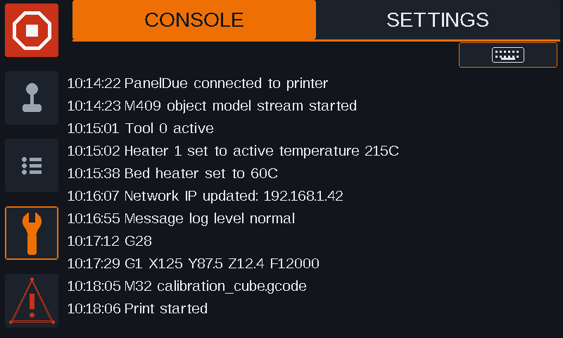

CONSOLE shows the rolling message log using the proven legacy console layout restyled for the modern 800×480 theme. The keyboard action remains available from the top-right of the content pane for direct command entry.

  ### SETTINGS
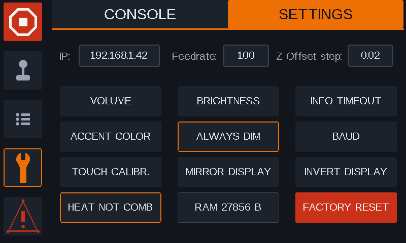

SETTINGS collects core PanelDue device settings such as volume, brightness, timeout, accent colour, baud rate, touch calibration and display orientation (ORIENTATION: NORMAL / MIRROR / INVERT / BOTH). FILAMENT selects the FILAMENT MANAGEMENT mode (AUTO / PANEL / MACROS). The page also exposes feedrate and Z offset defaults, a live free-RAM monitor and the factory-reset action. Screen dimming will dim the display to 5% after 180 s if no touch is detected. On touch it goes back to the set brightness and the counter restarts.


## Software Compatibility

RRF 3.5.2 onward


## Compatible Hardware

Duet3D PanelDue version:

v3-5.0

v3-7.0

v3-7.0c

5.0i

7.0i

## Firmware Downloads


### Latest builds (v11102026_v2)

| PanelDue model | Download |
| --- | --- |
| **v3 5.0"** | [Download latest](last%20versions%20compiled/paneldue_MODERN_UI_v3-5.0_v11102026_V2.bin) |
| **v3 7.0"** | [Download latest](last%20versions%20compiled/paneldue_MODERN_UI_v3-7.0_v11102026_V2.bin) |
| **v3 7.0c** | [Download latest](last%20versions%20compiled/paneldue_MODERN_UI_v3-7.0-c_v11102026_V2.bin) |
| **5.0i** | [Download latest](last%20versions%20compiled/paneldue_MODERN_UI_5.0-i_v11102026_V2.bin) |
| **7.0i** | [Download latest](last%20versions%20compiled/paneldue_MODERN_UI_7.0-i_v11102026_V2.bin) |


Instructions on how to update your PanelDue can be found on the Duet3D site:
https://docs.duet3d.com/User_manual/RepRapFirmware/Updating_PanelDue

## Repository status

This project is a community-maintained fork. For the latest information about supported hardware, firmware compatibility, building, installation, and configuration, please check the repository documentation and open issues.
Also check Discord. Most of the discussion is done there. ( https://discord.gg/mPFXxvBWT )
Firmware / Firmware-forum / NEW UI for old PANEL DUE on RRF 3.6.x


## Original project

- [Duet3D PanelDue Firmware](https://github.com/Duet3D/PanelDueFirmware)
- [Duet3D documentation](https://docs.duet3d.com/)

## License

Please refer to the original project and the license files in this repository for licensing information.
